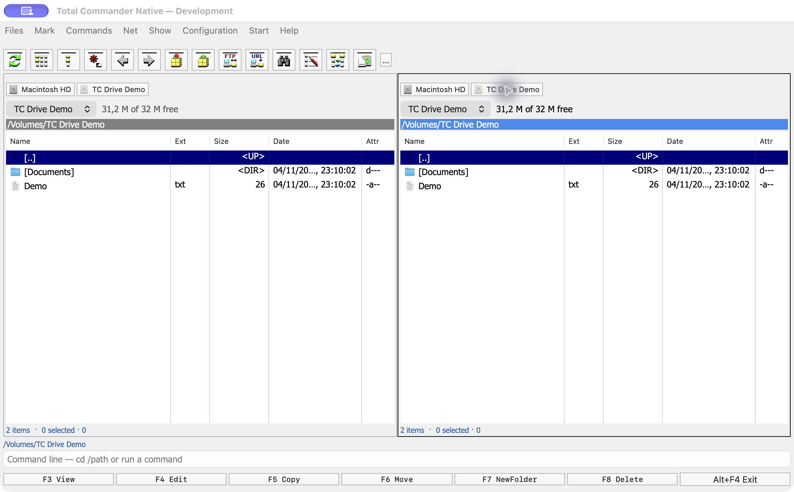
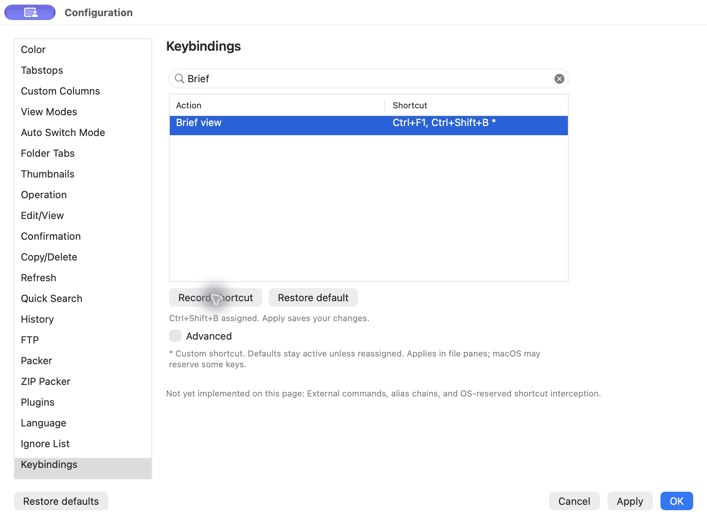
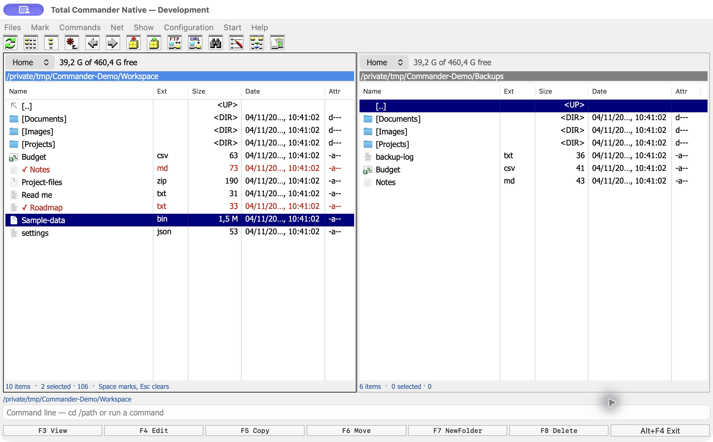
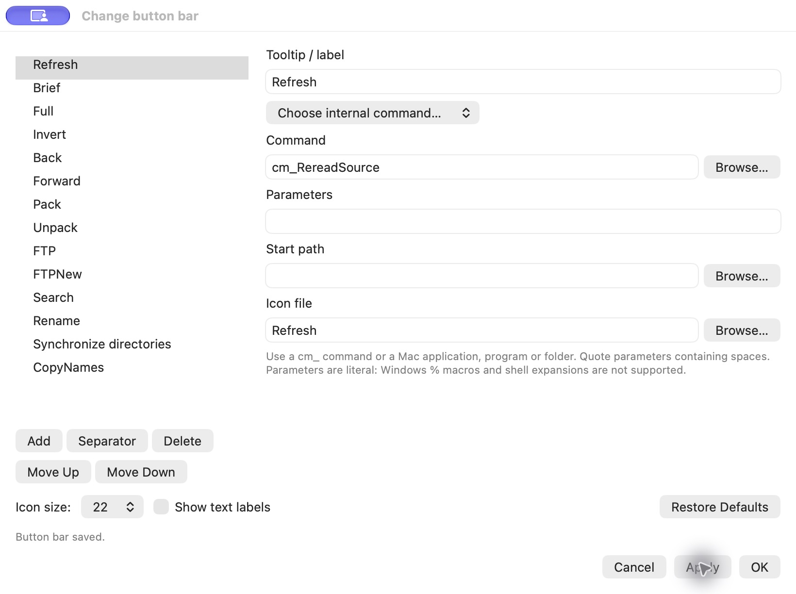
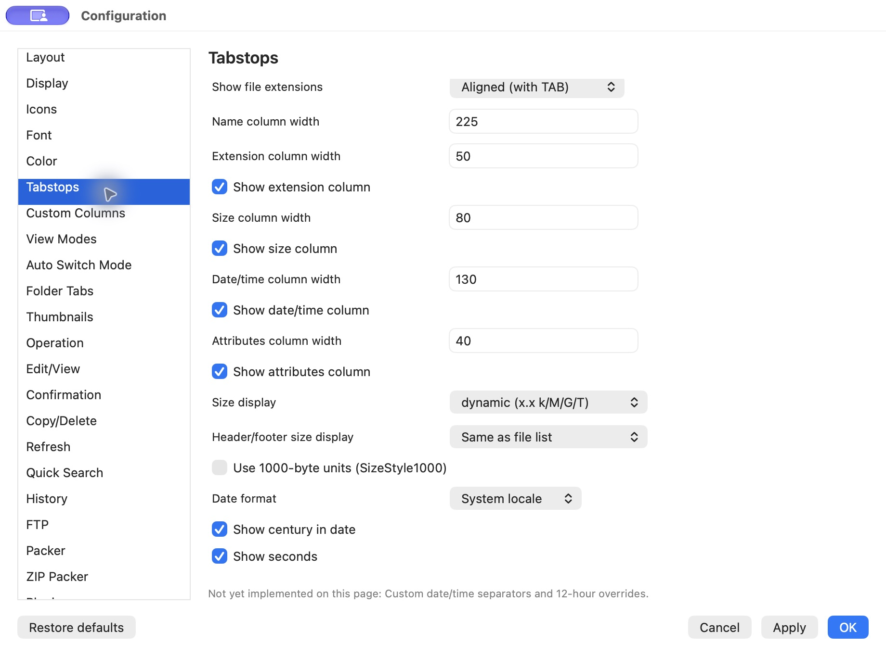

## New in 0.11.0

Each pane now has its own drive-button bar with macOS volume names and icons. Mounted USB, external and network volumes update automatically when macOS mounts, unmounts or renames them. Toggle **Configuration → Layout → Show drive buttons** independently of the drive combobox.



## New in 0.10.0

Keybindings now uses a searchable **Action / Shortcut** list with **Record shortcut**, **Restore default**, and a collapsed **Advanced** section. New Display, Tabstops and History controls add directory decorations/counts, sorting policies, Brief width limits and saved local directory history.



The [original settings audit](analysis/settings-audit.md) identifies implemented, partial, missing and platform-specific options. This release does not implement every original setting.

# Total Commander Native

A native, keyboard-driven dual-pane file manager for **Apple Silicon · macOS 13+**. Browse your Mac folders and mounted volumes directly, with a classic Total Commander-style interface—no Wine or Windows runtime.

**0.11.0 development build.** This is an independent reconstruction, not an official Ghisler release or a complete port. [Compatibility and remaining work →](analysis/remaining-parity-gaps.md)

[Download a build](https://github.com/CristiMachine25/total-commander-native/releases) · [Test results](TEST-RESULTS.md) · [Feature coverage](analysis/native-coverage.md)



*Screenshots use temporary, generated demo files. No personal folders or documents are shown.*

## Install

1. Open the [releases page](https://github.com/CristiMachine25/total-commander-native/releases).
2. Download `Total-Commander-Native-development.dmg`.
3. Open the disk image, drag **Total Commander Native** into **Applications**, and launch it.

Builds are ad-hoc signed, not Developer ID notarized. Release assets include source code, checksums, and verification details.

## Work with files

- **Browse:** Full, Brief, thumbnail and directory-tree views; tabs, history, filtering, and one or two separate trees.
- **Manage:** Copy/move queues, collision handling, multi-rename, checksums, split/combine, and copy-only directory synchronization.
- **Inspect:** Native text, hexadecimal and image viewing; bounded UTF-8 editing and text comparison.
- **Open archives:** Browse supported ZIP/ZIP64, password ZIP, 7z, TAR/compressed TAR, GZIP, BZIP2, XZ and tested RAR variants. Archive writes are limited to supported ordinary ZIP sessions.
- **Connect:** FTP/FTPS directories and transfers in the main panes. FTP requires MLSD; SFTP and resume remain unsupported.

### Keyboard and mouse

| Action | Shortcut |
|---|---|
| Return from the command/path field to the file list | **Esc** |
| Move through files | **↑ / ↓** |
| Mark/unmark a file and advance | **Space** |
| Switch panes | **Tab** |
| Open the focused file or folder | **Return** |
| View / Edit | **F3 / F4** |
| Copy / Move | **F5 / F6** |
| New folder / Delete | **F7 / F8** |
| File context menu | **Right-click**, **Control-click**, or **Shift+F10** |
| Select nonadjacent rows with the mouse | **⌘-click** |
| Enter a folder path | **⌘L** |

To select scattered files without a mouse, focus the file list, move with the arrows, and press **Space** on each wanted file. A checkmark identifies each marked file; the blue row is the current cursor position. **⌘Space** is macOS Spotlight, not file selection.

Some Mac keyboards require **Fn** for function keys. Supported original Control shortcuts keep **Control**; supported Alt shortcuts use **Option**. The context menu provides the app's native actions, not Windows shell extensions.

## Customize the button bar



Open **Configuration → Button Bar…**, right-click a toolbar button and choose **Change…**, or click the **…** button at the end of the bar.

Add or delete buttons, move them up/down in the order, and insert separators. Each button can run a supported internal command or open a Mac app, program, file or folder. Choose a tooltip/label and optional image file; executable programs accept quoted literal parameters and a local start path. Icon sizes range from 16–48 pixels, with optional text labels and horizontal scrolling for long bars.

**Apply** saves and redraws immediately; **OK** also closes the editor. **Cancel** discards edits made since the last Apply. **Restore Defaults** stages the original 14 buttons until you apply. The bar is saved separately from the general JSON settings editor. Show/hide it through **Configuration → Options → Layout → Show button bar**.

This is one native horizontal bar. Windows `.bar` files, nested/vertical bars, DLL icons, and Total Commander parameter macros are not supported yet. Parameters do not expand shell variables or wildcards.

## Make it yours



**Configuration → Options → Tabstops** controls file-size display: bytes, kilobytes, automatic units, or fixed MB/GB. Header/footer units can be chosen separately, with 1000- or 1024-byte bases.

The app currently saves **105 top-level settings, including structured column sets, view modes, rules and dark palettes** for layout, fonts, colors, icons, columns, tabs, viewing, quick search and more. Not every original setting is implemented; unsupported categories identify their missing options.

Working configuration pages include:

- **Keybindings:** searchable native commands, recorded shortcuts, conflict detection, New/Assign/Remove/Reset, and command aliases. Valid pending edits are collected on Apply; removing an override restores the built-in binding.
- **Color:** Light, Dark or Follow macOS, with an independent dark palette. The original Dark ↔ Normal command works.
- **Folder Tabs:** optionally retain each tab’s manual view, custom columns, named mode, sorting, filters and selection; local tabs restore these with the saved session.

- **Custom Columns:** up to 29 saved sets with ordered captions, field expressions, widths and alignment; choose a set from Show or Shift+F1. Built-in metadata, date formatting, substrings and conditional text are supported.
- **View Modes:** named column layouts, primary/secondary sorting, filters, colors and tab appearance, with supported native enter/leave commands.
- **Auto Switch Mode:** ordered folder/provider/file-mask rules, AND/OR/NOT conditions and file-percentage thresholds, applied after successful navigation with optional default restoration.

- **Copy/Delete and Confirmation:** local copy/move destination and overwrite policies, metadata preservation, copy verification, buffer size, and Trash preference. Permanent deletion always confirms the actual files.
- **Refresh:** activation refresh, optional local-folder monitoring, foreground-only operation and excluded paths. Metadata polling is opt-in, nonrecursive and runs off the UI thread.
- **Packer / ZIP Packer:** compression level 0–9, integrity check after packing, newest-source timestamp and local archive browsing preference.
- **FTP:** defaults for passive/active mode, connection/transfer timeouts and destination pane; existing sessions retain their settings.
- **Folder Tabs:** local tab locking, optional close on double-click, close-other-tabs confirmation and lock markers.
- **Color / Tabstops:** alternating Full/Brief rows, custom date/time separators and 12-hour display.
- **Confirmation:** custom internal-command shortcuts and aliases, for example `Ctrl+Shift+B=cm_SrcShort` and `brief=cm_SrcShort`. Separate multiple definitions with semicolons. OS-reserved shortcuts remain under macOS control.

[Copy/delete behavior](analysis/copy-delete-settings.md) · [Archive/FTP defaults](analysis/archive-ftp-settings.md) · [Refresh/display behavior](analysis/refresh-display-settings.md) · [Shortcut syntax](analysis/shortcut-settings.md)

**Configuration → Change Settings Files Directly…** opens the native JSON editor. Export/import the complete native settings, or import a documented subset of `wincmd.ini`. Windows options that cannot be mapped are reported. Imports are staged for review before Apply and do not silently modify the source file. [Configuration-file format and supported INI keys →](analysis/configuration-files.md)

## Performance and compatibility

Formatter reuse, cached settings pages and menu resources, reusable file cells, and reduced metadata queries improve responsiveness. The [settings benchmarks](analysis/configuration-performance.md), [pane benchmarks](analysis/pane-responsiveness.md) and [directory-listing benchmarks](analysis/directory-listing-performance.md) document the measured gains and limits. These are measurements on the test Mac, not proof of Windows-equivalent speed.

Full Windows plugin support, all original settings and shortcuts, Windows content-plugin columns and platform-specific view rules, complete archive/FTP options, and pixel-identical rendering remain unfinished. Synchronization does not mirror deletions; Ignore List currently filters displayed entries only. See [remaining differences](analysis/remaining-parity-gaps.md) and the release-specific [validation ledger](TEST-RESULTS.md).

## Build and test

Requires an Apple Silicon Mac, Xcode command-line tools, and Python 3. The native ARM64 archive tool is bundled.

```sh
python3 build.py
```

Run the test suite with its local FTP fixture dependencies:

```sh
python3 -m venv .build/test-env
.build/test-env/bin/python -m pip install pyftpdlib pyOpenSSL
FTP_TEST_PYTHON="$PWD/.build/test-env/bin/python" bash test.sh
```

Tests use disposable files and localhost servers. To package a release after building and committing all source/documentation changes:

```sh
python3 package.py
```

Packaging rejects a compiled stage whose source hashes no longer match the checkout, verifies the ad-hoc signature and DMG, and archives the committed source. Generated release artifacts are excluded from Git.

[Source-history notes](HISTORY.md) · [Reconstruction evidence](analysis/decompilation.md) · [Third-party notices](THIRD-PARTY.txt)

## License

Original code and documentation in this project are licensed under the [MIT License](LICENSE).

Third-party components and material are excluded from that grant and retain their original rights and terms. This includes 7-Zip, the Total Commander application icon and toolbar artwork, and the original menu and command definitions. See [third-party notices](THIRD-PARTY.txt). The MIT license does not grant rights to those materials or to the Total Commander name or trademarks.

Version 4 configuration files migrate versions 1–3. Original INI import now supports a validated subset of CustomFields, ViewModes and ViewModeSwitch; unsupported Windows/plugin semantics are reported, and linked invalid profiles leave existing profiles intact. [INI import scope](analysis/original-display-ini.md) · [Keybindings](analysis/keybindings.md) · [Appearance](analysis/appearance-settings.md) · [Per-tab views](analysis/per-tab-view-settings.md)
